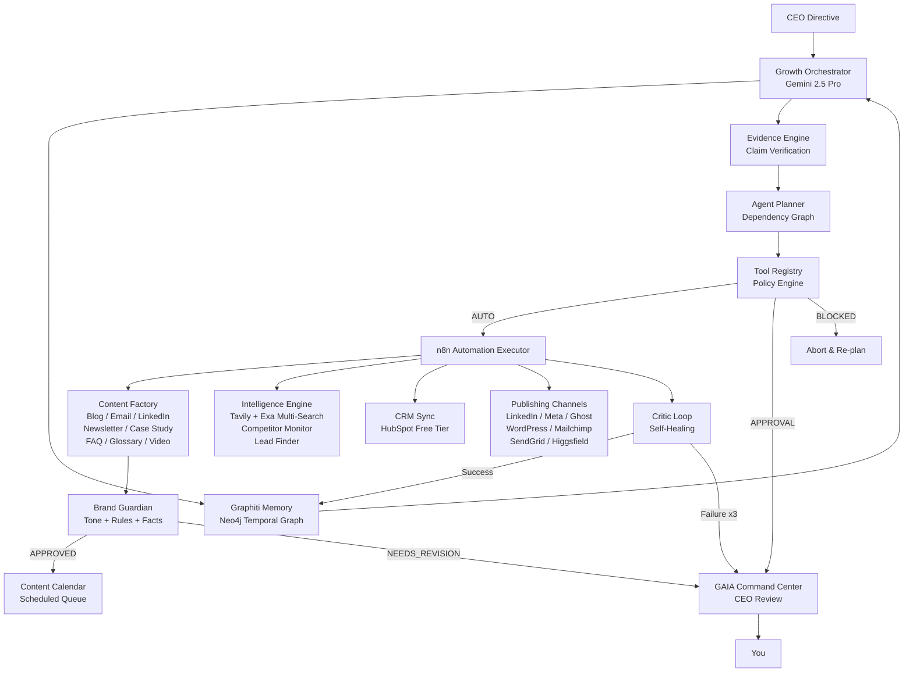

# GAIA — Growth AI Agent

**GAIA** is a fully autonomous Growth Operating System. Not a chatbot. Not a collection of n8n automations. A goal-driven engine that observes market signals, reasons with live memory, plans multi-step campaigns, executes them across your entire stack, and learns from every outcome — continuously, without being prompted.

You give it one measurable goal. It does the rest.

---

## Concept

Most growth tools are reactive — you open them, you tell them what to do, you wait. GAIA inverts this. You set a North Star metric (e.g., *"Grow pipeline by 30% by Q4"*) and GAIA operates autonomously in **CEO Mode**: scanning for opportunities, writing and publishing content, finding and enriching leads, running experiments, monitoring competitors, and escalating only the decisions that require your approval.

Every action it takes is grounded in your company's specific brand voice, ICP, and evolving memory. It knows what it tried last quarter. It knows what failed. It never invents facts.

---

## Architecture



---

## What GAIA Does

### Content Factory
Generates every type of marketing content from a single topic directive, all calibrated to your brand voice and active ICP:

| Content Type | Description |
|---|---|
| **Blog / Article** | SEO-optimized long-form with H1/H2 structure, meta description, and CTA |
| **Newsletter** | Subject line, preheader, 3-story structure, one CTA — under 400 words |
| **Email Sequence** | 3-touch cold outreach with subject lines and timing notes |
| **LinkedIn Post** | Hook → insight → CTA → hashtags. Mobile-optimized line breaks |
| **Instagram Caption** | Hook, story, CTA, 20-25 hashtags below the fold |
| **Case Study** | Challenge → Solution → Quantified Results → Stakeholder Quote |
| **FAQ** | 8-12 questions structured for Answer Engine Optimization (AEO) |
| **Glossary** | Brand-owned term definitions that position you as a category authority |
| **Video Script** | 60/90/180s scripts with scene directions and B-roll notes |
| **Image Brief** | DALL-E 3 / Stability AI prompts calibrated to brand color palette |
| **Video Prompt** | Higgsfield AI prompts with camera movement, scene, and mood specs |

Every output passes through the **Brand Guardian** before it can be scheduled — a Gemini Flash enforcement layer that checks tone alignment, rule compliance, forbidden phrases, and unverified factual claims, returning an APPROVED / NEEDS_REVISION / REJECTED verdict with annotated line-level feedback.

### Content Repurposing Engine
One blog post → newsletter + LinkedIn post + Instagram caption + email summary + FAQ extract + video script. Automatically. Each output format-adjusted for its channel and re-reviewed by the Brand Guardian.

### Intelligence Engine
- **Competitor Monitoring**: Daily scans of competitor websites, pricing pages, job postings, and ad copy using Tavily + Exa in parallel. Detects pricing drops, new feature launches, and messaging pivots. Scores threat level and surfaces to the Competitor Intelligence Board.
- **Multi-Engine Search**: Queries Tavily and Exa simultaneously, merges and deduplicates results, then synthesizes the best combined answer. You configure which engines are active.
- **Lead Finding**: Searches for companies matching your active ICP, scores them 0–100 against ICP fit criteria, enriches with company size and tech stack, and pushes qualified leads (score > 70) to HubSpot automatically.

### Experiment Engine
GAIA formulates formal A/B hypotheses, creates control and treatment variants, tracks statistical confidence, and writes concluded experiments to Graphiti memory so failed hypotheses are never repeated.

### Campaign Orchestrator
Coordinates multi-channel campaigns as a single unified motion: Blog (Day 1) → LinkedIn post (Day 2) → Email (Day 3) → Instagram (Day 5). Generates UTM schemas, manages scheduling, and pulls live performance metrics from each channel.

### Policy Engine
Every tool GAIA can invoke is bound by a policy contract:
- **AUTO** — Executes immediately (analytics, search, read operations, lead scoring)
- **APPROVAL** — Halts and surfaces to the Command Center for your decision (publishing, CRM writes, email sends)
- **BLOCKED** — Globally forbidden under any circumstance (bulk deletes, data exports)

---

## Stack

### Backend
| Layer | Technology |
|---|---|
| **API** | Python FastAPI (async) — 9 modular route modules |
| **LLM Brain** | Google Gemini 2.5 Pro with function calling |
| **Memory** | Graphiti temporal knowledge graph (Neo4j) |
| **Task State** | PostgreSQL + SQLAlchemy async — 12 data models |
| **Task Queue** | Redis + Celery for async agent task execution |
| **Automations** | n8n (self-hosted) connected via REST API |
| **Search** | Tavily + Exa queried in parallel, results merged |
| **Encryption** | AES-256 (Fernet) for all stored API keys |
| **Logging** | structlog with structured JSON output |

### Frontend
| Layer | Technology |
|---|---|
| **Framework** | Vite + React + TypeScript |
| **Styling** | Tailwind CSS v4 with Dala design system tokens |
| **Design System** | Void black canvas, Electric Iris `#8052ff` accent, Inter ultra-light |
| **Animations** | Canvas-based ambient particle system (triangles, brand colors) |
| **State** | React hooks + REST polling — WebSocket ready for real-time logs |

### Infrastructure
| Service | URL | Purpose |
|---|---|---|
| **GAIA API** | `http://localhost:8001` | FastAPI backend |
| **GAIA UI** | `http://localhost:5173` | React command center |
| **n8n** | `http://localhost:5678` | Automation orchestration |
| **Neo4j** | `http://localhost:7474` | Graphiti graph browser |
| **Postgres** | `localhost:5432` | App state database |
| **Redis** | `localhost:6379` | Celery task queue |

---

## Command Center UI

The GAIA Command Center is the interface between you and the autonomous agent. Built on the Dala design system — void-black canvas, no cards or borders, hierarchy through typographic scale alone.

| View | Description |
|---|---|
| **Growth Terminal** | Issue CEO directives. The agent streams its reasoning (Observe → Plan → Decide) and returns a structured execution plan with thought-process toggle |
| **Context Graph** | Live SVG force-directed visualization of your Graphiti temporal knowledge graph — all companies, ICPs, competitors, campaigns, and decisions as nodes |
| **Automation Workflows** | Live n8n workflow status table — active/inactive, last run, tags, and per-row trigger button. Falls back to mock data if n8n API key is not yet set |
| **Policy Holds** | All pending APPROVAL actions with risk badges, rationale, and Approve / Block controls wired to real API persistence |
| **Content Calendar** | Scheduled content queue with status badges (Draft / In Review / Scheduled / Published / Failed) — drag to reschedule, one-click Repurpose |
| **Task Board** | Real-time Kanban of agent tasks: Queued → Running → Done / Failed. Shows skill invoked, retry count, and log stream |
| **Competitor Board** | Intelligence signals from daily scans — pricing changes, new features, messaging pivots. One-click generates counter-content |
| **Lead Board** | All discovered leads with ICP score, enrichment data, and sequence trigger |
| **Experiment Manager** | A/B hypothesis lifecycle — create, track confidence, declare winner, record failures to memory |
| **Telemetry** | North Star progress bar, content performance, lead funnel, experiment results, and agent ROI (time saved, cost per output) |
| **Settings** | Brand voice, ICP library, stack selector (toggles which MCP integrations are active), CEO goal config, encrypted API key vault |

---

## Data Models

GAIA tracks 12 entity types in Postgres and all relationships in the Graphiti Neo4j graph:

`Company` · `BrandVoice` · `ICP` · `CEOGoal` · `StackConfig` · `EncryptedKey` · `PolicyHold` · `AgentTask` · `ContentDraft` · `Experiment` · `Lead` · `APIUsageLog`

---

## Agent Skills

GAIA is built on the Antigravity agent skill system. Skills live in `.agents/skills/`:

| Skill | Purpose |
|---|---|
| `growth-orchestrator` | Master router — enforces the core loop and CEO Mode, manages the Policy Registry |
| `agent-planner` | Breaks objectives into ordered dependency graphs; runs the Plan → Execute → Critic loop |
| `decision-engine` | Structured decision-making, confidence scoring, escalation thresholds |
| `context-engine` | Builds task context from company config, memory, and live data signals |
| `evidence-verification` | Verifies every factual claim before action — returns "unknown" rather than hallucinating |
| `graphiti-memory` | Temporal knowledge graph client — every fact has a source, timestamp, and confidence score |
| `growth-strategy` | Opportunity scanner, experiment engine, funnel design |
| `marketing-ops` | Connects strategy decisions to execution paths |
| `agent-evals` | Regression tests: hallucination rate, tool-selection accuracy, policy compliance |
| `agent-observability` | Traces, latency, costs, and the full decision audit trail |

---

## Integrations

All integrations are opt-in. Configure only what your stack uses in the Settings view. GAIA auto-configures the relevant MCP connections based on your selection.

**Content Channels**: LinkedIn · Meta (Facebook + Instagram) · Ghost · WordPress  
**Email**: SendGrid (free tier: 100/day) · Mailchimp  
**CRM**: HubSpot (free tier) · Salesforce  
**Search**: Tavily · Exa (multi-engine, parallel)  
**Image Generation**: DALL-E 3 · Stability AI  
**Video Generation**: Higgsfield AI (MCP slot — user provides key)  
**Productivity**: Google Workspace (Gmail, Calendar, Drive via OAuth)  
**Automation**: n8n (self-hosted, free)

---

## Growth Packs

Pre-configured vertical templates in `data/packs/`:
- **`saas/`** — MQLs, SQLs, G2 review scraping, B2B outreach sequences
- **`ecommerce/`** — ROAS, cart abandonment recovery, D2C retention flows

---

## Growth Playbooks

Pre-built end-to-end GTM motions in `data/playbooks/`. GAIA pattern-matches active signals to the right playbook and executes it autonomously:

| Playbook | Trigger | Actions |
|---|---|---|
| `competitor_pricing_drop` | Competitor lowers price | Publish comparison content, update SEO pages, trigger win-back outreach |
| `product_launch` | Launch event | Countdown posts → launch email → LinkedIn → PR pitch → follow-up sequence |
| `lead_gen_sprint` | Goal: 10 SQLs in 14 days | LinkedIn scrape → enrich → ICP score → personalized 3-touch sequence |

---

## Running GAIA

### 1. Environment Setup
```bash
# Copy and fill in your credentials
cp .env.example .env
# Minimum required: GEMINI_API_KEY, then add others as you configure each integration
```

### 2. Start Infrastructure
```bash
docker compose up -d
# Starts: Postgres, Neo4j, Redis, n8n
```

### 3. Start the API Backend
```bash
cd backend
pip install -r requirements.txt
python -m uvicorn backend.main:app --port 8001 --reload
# → http://localhost:8001
```

### 4. Start the Command Center UI
```bash
cd frontend
npm install
npm run dev
# → http://localhost:5173 (or next available port)
```

### 5. First Run
Open the UI. The **Onboarding Wizard** will guide you through:
1. Company profile and industry
2. ICP definition (who you're selling to)
3. Brand voice rules and forbidden phrases
4. Stack selection (which integrations to activate)
5. API key entry (encrypted and stored — never hardcoded)
6. North Star goal setting

GAIA writes all of this to Graphiti memory and begins its first intelligence scan.

> See `guide.md` (gitignored) for local service credentials and first-run notes.

---

## API Cost Monitoring

GAIA tracks every LLM call, search query, and content generation action with its USD cost estimate. The Telemetry view shows daily and monthly spend with a configurable alert threshold. Set `COST_ALERT_THRESHOLD_USD` in your `.env` to get notified when you approach your budget.

---

## Documentation

- [Agent Design](./docs/agent-design.md)
- [Architecture Blueprint](./docs/architecture.md)
- [Memory Layer](./docs/memory.md)
- [Automation Workflows](./docs/automation.md)
