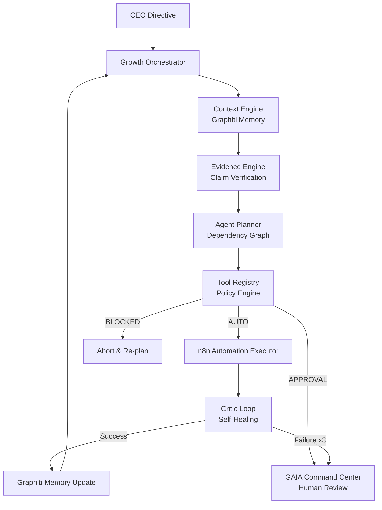

# GAIA — Growth AI Agent

**GAIA** (Growth AI Agent) is a fully autonomous Growth Operating System. It is not a collection of automations — it is a goal-driven engine that observes, reasons, plans, executes, and learns in a continuous loop to move a single measurable business metric.

---

## What GAIA Does

GAIA operates in **CEO Mode**: you give it a quantitative goal (e.g., *"Grow pipeline by 30% in Q4"*) and it continuously decides what actions could move that metric. It scans for opportunities, formulates hypotheses, runs experiments, and escalates only the decisions that require your approval.

---

## Architecture



---

## Core Layers

### 1. The Autonomous Core Loop
The Growth Orchestrator enforces the strict **Observe → Verify → Plan → Decide → Execute → Learn** cycle for every objective. It does not execute one-shot prompts.

### 2. Tool Registry & Policy Engine
Every action the agent can take is bound by a policy contract defined in `growth-orchestrator/registry.py`:
- **AUTO** — Executes immediately (e.g., SEO analysis, market scan).
- **APPROVAL** — Halts and surfaces to the Command Center for your decision (e.g., publishing content, CRM writes).
- **BLOCKED** — Globally forbidden at all times (e.g., deleting records).

### 3. Evidence Engine
Before acting on any factual claim, GAIA routes it through `evidence-verification/scripts/verifier.py`. Claims that fail confidence thresholds are marked `[REJECTED]` and the agent halts rather than hallucinating. The agent will say *"unknown"* rather than invent an answer.

### 4. Temporal Knowledge Graph (Graphiti)
GAIA stores companies, ICPs, campaigns, leads, competitors, and experiment outcomes as a living temporal graph — not flat JSON. Every fact has a source, timestamp, confidence score, and validity window.

### 5. Planner → Executor → Critic Loop (PEC)
The agent does not fail silently. If an execution step fails (API timeout, bad data), the Critic diagnoses it, updates the plan with a retry or fallback, and resubmits. After 3 consecutive failures the plan is marked `BLOCKED` and escalated.

### 6. Explainability Layer
Before every tool call, the agent logs its rationale to `decision_audit.log` — what goal it was driving, what memory it retrieved, what constraints it applied, and why it selected that specific tool.

### 7. Opportunity Engine
The `growth-strategy/scripts/opportunity_scanner.py` continuously scores raw signals (competitor changes, traffic drops, market trends) against the active CEO goal and marks high-impact ones as `[ACTIONABLE]`.

### 8. Experiment Engine
Rather than blindly repeating tactics, GAIA formulates formal hypotheses via `growth-strategy/scripts/experiment_engine.py`, tracks A/B variants, and explicitly records failures into Graphiti so they are never repeated.

---

## GAIA Command Center (Frontend)

A full-stack web interface for interacting with and monitoring the Growth OS.

**Frontend**: Vite + React + TypeScript, styled with the Dala design system (void-black canvas, Electric Iris `#8052ff` accent, ultra-light Inter typography).

**Backend**: Python FastAPI bridging the frontend to the agent skills, Postgres/pgvector, and n8n.

### Views
| View | Description |
|---|---|
| **Terminal** | Issue CEO directives. The agent streams its thought process and responds with categorised reasoning. |
| **Context Graph** | SVG force-directed visualisation of the Graphiti temporal knowledge graph. |
| **Workflows** | Live n8n automation status — see which workflows are active, when they last ran, and trigger them manually. |
| **Policy Holds** | Approve or block actions that require human sign-off before the agent can proceed. |
| **Settings** | Configure the active CEO goal, n8n API key, and agent integration settings. |

### Running the Command Center

```bash
# 1. Start the API backend
cd backend
pip install -r requirements.txt
python -m uvicorn main:app --port 8001 --reload

# 2. Start the frontend
cd frontend
npm install
npm run dev
# → http://localhost:5173
```

---

## Infrastructure

GAIA runs on a local Docker stack. Start everything with:

```bash
docker compose up -d
```

| Service | URL |
|---|---|
| n8n Automation | http://localhost:5678 |
| Postgres + pgvector | localhost:5432 |
| GAIA API | http://localhost:8001 |
| GAIA UI | http://localhost:5173 |

> See `guide.md` (gitignored) for credentials and first-run instructions.

---

## Skill Stack

GAIA is built on the Antigravity agent skill system. Skills live in `.agents/skills/`:

| Skill | Purpose |
|---|---|
| `growth-orchestrator` | Master router: enforces the core loop and CEO Mode |
| `agent-planner` | Breaks objectives into dependency graphs; runs the PEC loop |
| `decision-engine` | Structured decision-making, confidence scoring, escalation |
| `context-engine` | Builds task context from business config and live data |
| `evidence-verification` | Verifies claims before any action is taken |
| `graphiti-memory` | Temporal knowledge graph client |
| `growth-strategy` | Opportunity scanner, experiment engine, funnel design |
| `marketing-ops` | Connects strategy to execution |
| `agent-evals` | Regression tests: hallucination rate, tool-selection accuracy, policy compliance |
| `agent-observability` | Traces, latency, costs, and decision audit trail |

---

## Growth Packs

Pre-configured vertical templates in `data/packs/`:
- `saas/` — MQLs, SQLs, G2 scraping, B2B outreach
- `ecommerce/` — ROAS, cart abandonment, D2C retention

---

## Documentation

- [Agent Design](./docs/agent-design.md)
- [Architecture Blueprint](./docs/architecture.md)
- [Memory Layer](./docs/memory.md)
- [Automation Workflows](./docs/automation.md)
