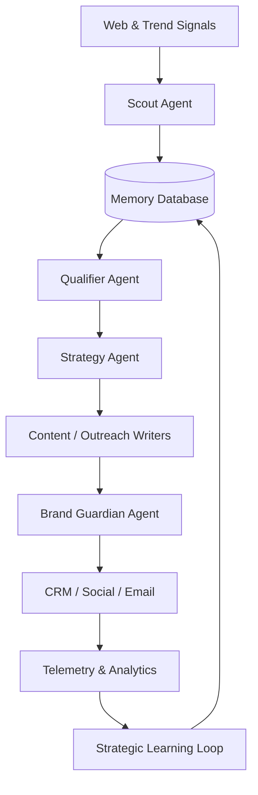

# Growth-Agent — AI-Powered Growth Operations Agent

**Growth-Agent** is a fully autonomous, AI-driven marketing and growth engine. It is designed to act as a virtual Growth Operations manager that can scout trends, qualify leads, generate content, monitor analytics, and orchestrate complex workflows.

---

## 🚀 Core Capabilities

1. **Intelligence Scouting**: The agent constantly monitors the web, competitors, and trends to inject "signals" into the core memory.
2. **Autonomous Reasoning**: Utilizing a Qualifier Agent, raw signals are scored to determine if they present viable growth opportunities.
3. **Content Engine**: Automatically drafts, edits, and finalizes blog posts, newsletters, and social media content based on validated opportunities.
4. **Brand Guardian**: An internal auditor agent that ensures all generated content adheres to the configured brand voice and avoids hallucinations or off-brand claims.
5. **Autonomy & Learning**: The agent uses feedback loops to prune underperforming strategies and double down on winning approaches.

---

## 🗺️ Architecture

---

## ⚙️ How It Works

1. **Input**: Real-time signals from web scraping, APIs, or internal databases.
2. **Context**: The agent reads the AI Knowledge Base (ICPs, Product Guides, Brand Voice).
3. **Memory Retrieval**: It cross-references the signals with past outcomes in the Memory Layer.
4. **Reasoning**: It scores the opportunity and decides if it warrants an action (e.g., writing a blog post, reaching out to a lead).
5. **Workflow Execution**: It triggers n8n workflows to generate the content or perform the outreach.
6. **Result Analysis**: The Strategic Learning Loop measures the outcome.
7. **Memory Update**: The database is updated with the results for future reference.

---

## 🛠️ Installation & Setup

1. **Clone the repository**.
2. **Configure Environment**: Copy `.env.example` to `.env` and fill in your API keys (OpenAI, Gemini, CRM, Newsletter).
3. **Setup Memory**: 
   - Ensure you have a Postgres database (e.g., Supabase).
   - Run the SQL migration files located in `memory/schema/` sequentially.
4. **Configure Knowledge Base**:
   - Navigate to `data/examples/` and modify `Example_Company_Voice.json` and `ICP_Definitions.json` to match your organization.
5. **Import Workflows**:
   - Start an [n8n](https://n8n.io/) instance.
   - Import the JSON workflows from the `workflows/` directory.

---

## 📖 Documentation

For deep technical insights into how the agent operates, see the `docs/` folder:
- [Agent Design](./docs/agent-design.md)
- [Architecture Blueprint](./docs/architecture.md)
- [Memory Layer](./docs/memory.md)
- [Automation Workflows](./docs/automation.md)

---

## 🔮 Roadmap

- **Extended Integrations**: More out-of-the-box support for CRMs (Salesforce, HubSpot).
- **Multi-modal Content**: Allowing the agent to generate and publish short-form video scripts and image prompts.
- **Enhanced AEO**: Native Answer Engine Optimization to track brand mentions across Perplexity, ChatGPT, and Gemini.
